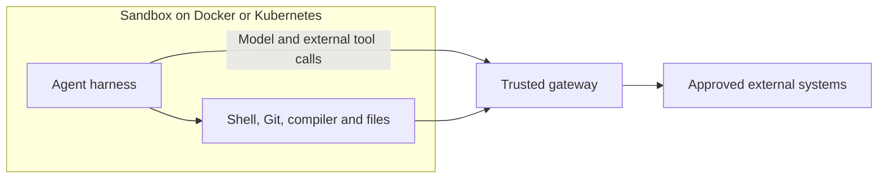
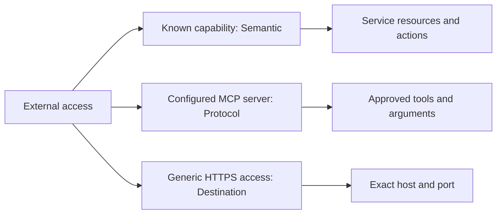
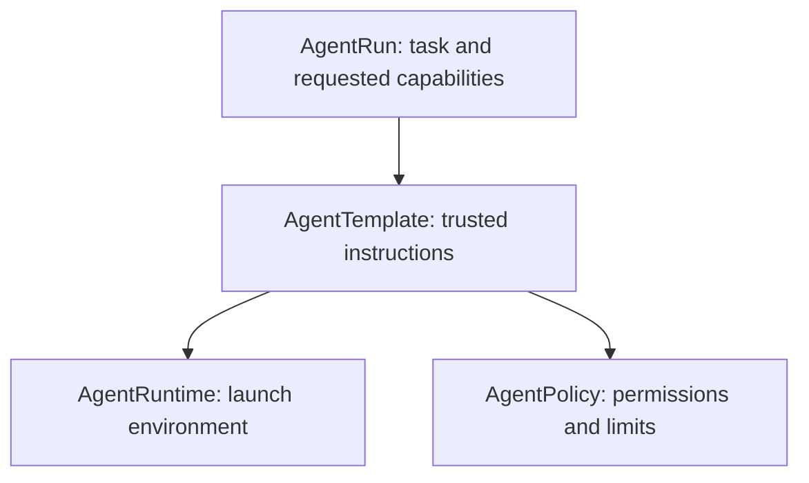
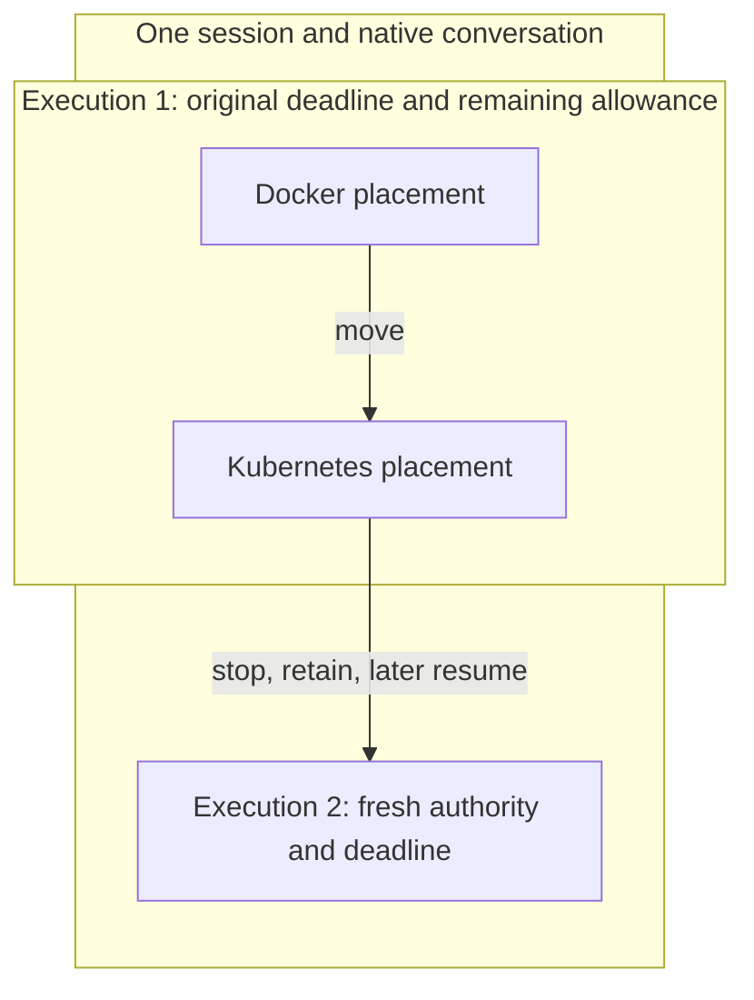
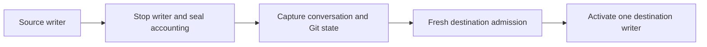
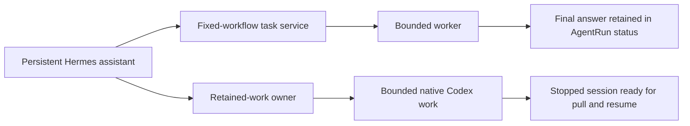

# Sproozi

Sproozi runs existing AI agents in controlled environments, governs their access
to external systems, and preserves their conversations and workspaces so you can
continue the work elsewhere.

You can ask Codex to investigate a problem in Kubernetes, let it finish while
your laptop is offline, then pull the session and continue the same conversation
locally. Or start an interactive session in Docker and move it to an approved
cluster while keeping its unfinished work. Sproozi manages execution, access and
continuity; the native agent still decides how to carry out the task.

This is a preview for evaluation. The concepts below describe the implemented
architecture; [support and verification](#support-and-verification) lists the
tested paths and their limits.

Start with the [Kind walkthrough](docs/guides/getting-started.md),
[install on an existing cluster](docs/guides/install-kubernetes.md), or read on
for the architecture.

## An agent works inside a sandbox

A harness such as Codex or Claude Code owns the agent loop. It reads the task,
calls the model and chooses tools. Its runtime supplies the filesystem and local
tools, such as a shell, Git or a compiler. A Docker or Kubernetes executor
provides the isolated environment in which that harness runs.

The useful boundary is external access. `git diff` works on local files;
fetching a repository or publishing a pull request reaches another system.
Installing `kubectl` gives the agent a command, while a capability determines
which cluster resources it may access.

The gateway checks the live run identity and policy, authorises the operation,
and supplies upstream credentials. Provider credentials stay outside the sandbox.
Enforcing this route requires network isolation as well as gateway checks. On
Kubernetes, Sproozi generates policy allowing DNS and gateway egress. Operators
must use an enforcing CNI and probe direct access, accounting for NetworkPolicy's
node-traffic exceptions.

The [harness reference](docs/reference/harnesses.md) distinguishes ordinary runs
with Codex, Claude Code, OpenCode and Hermes from managed session movement,
which currently supports Codex and Claude Code.

## Capabilities control external access

Sproozi can understand an external call at three levels. The level determines
what the gateway can check about the operation.

A known capability has a service-specific handler. It can check a Kubernetes
namespace or the repository and branch involved in a GitHub operation. A
configured MCP capability exposes selected tools from an approved HTTPS server,
with discovered schemas and optional policy restrictions on arguments. A generic
destination grant permits an exact HTTPS destination, with less understanding of
the request's meaning.

Adding a compatible MCP server requires registration and policy configuration,
without a provider-specific Go adapter.

These levels are independent of how the agent makes the call. CLI, HTTP and MCP
are interfaces. The native Kubernetes MCP tool still receives Semantic
checks through the Kubernetes handler. Configured remote MCP tools receive
Protocol checks. Discovering a tool does not grant permission to call it.

[Capabilities and gateways](docs/explanations/capabilities-and-gateways.md)
explains each boundary. [Configured MCP](docs/reference/configured-mcp.md)
supports compatible HTTPS tool servers; managed stdio servers and OAuth consent
remain future work.

## Administrators define the bounds; a run supplies the task

An administrator decides which environment, instructions and permissions are
available. A caller selects an approved template and supplies a task with an
explicit capability subset. Task text cannot expand those permissions.

[`AgentTemplate`](docs/reference/agenttemplate.md) binds the trusted instructions
to an [`AgentRuntime`](docs/reference/agentruntime.md) and an
[`AgentPolicy`](docs/reference/agentpolicy.md). The runtime resource specifies the
administrator-owned Pod configuration, image, client launch, workspace and
gateway connection. This Kubernetes resource is distinct from the Docker or
Kubernetes executor.

`AgentPolicy` restricts capabilities and their resource scope, sets resource and
lifetime limits, and supports optional consumption budgets.
[`AgentRun`](docs/reference/agentrun.md) records the immutable task, event and
requested capabilities; cancellation remains available after submission.
The gateway continues to check live authority as the agent works.

The [system architecture](docs/explanations/system-architecture.md) describes how
these resources produce a sandbox, its identity and its immutable run contract.

## A session outlives an execution

A session identifies the conversation and working state you want to continue.
An execution is one authorised period of work, with its own deadline and
allowance. A placement is one visit to an executor during that execution.

Moving a running session preserves the execution's original deadline and
remaining allowance. Each placement receives a fresh allocation and identity;
each Kubernetes visit creates a fresh `AgentRun`. An execution can therefore
include several placements and several Kubernetes runs.

Resuming retained work later starts a fresh execution under a new grant while
continuing the same native conversation and Git workspace. The
[session guide](docs/guides/session-mobility.md) covers movement, and the
[retained-work guide](docs/guides/portable-workflows.md) covers remote Codex work
that you can pull and resume locally.

## Move the work; authorise the destination

A checkpoint contains selected native conversation state and the Git workspace,
including unfinished changes. This lets the agent continue the work it was doing.
Permissions, credentials and spending authority come from the destination's
trusted configuration and admission checks.

For a graceful move, Sproozi gates input, waits for supported active tools,
revokes access and confirms the source writer has stopped. It seals accounting
before capturing state. If stopping or usage remains uncertain, the destination
cannot activate. A checkpoint alone proves neither permission nor unused budget.

Pulling retained work first validates its stopped state and transfers ownership
to the home daemon. Pull does not start an agent; resume obtains fresh authority
and starts the next execution. The
[checkpoint decision](docs/adr/0008-selected-native-and-git-checkpoints.md) and
[retained-work decision](docs/adr/0012-retained-work-and-fresh-session-continuations.md)
describe these guarantees and their costs.

## A persistent assistant delegates bounded work

A persistent assistant can keep your conversation, memory and schedules while
individual workers start and finish. Stock Hermes runs separately with its
native state on persistent storage. Sproozi owns the workers' bounds and lifetime.

These paths preserve different results. The task service maps approved workflow
names to fixed templates and capability subsets, retaining the final answer
before worker cleanup. The retained-work owner also preserves native conversation
and Git state so someone can continue that work later. Neither path gives Hermes
Kubernetes control credentials.

Use the [Hermes orchestration guide](docs/guides/hermes-orchestration.md) for
fixed workflows and answers, or the
[retained-work deployment guide](docs/guides/retained-work-kubernetes.md) for
remote Codex work and local continuation.

## Get started

Choose the workflow you want to try. Each guide includes its prerequisites and
administrator setup.

| Goal | Guide |
| --- | --- |
| Run an agent that investigates a failing workload and proposes a PR | [Getting started in Kind](docs/guides/getting-started.md), with [manual acceptance checks](docs/guides/manual-pr-demo.md) |
| Install on an existing cluster and run a first credential-free Kubernetes read | [Install on Kubernetes](docs/guides/install-kubernetes.md) |
| Start a native terminal session and move between Docker and Kubernetes | [Session mobility](docs/guides/session-mobility.md) |
| Submit remote Codex work, then pull and resume it locally | [Retained work](docs/guides/portable-workflows.md) |
| Connect persistent Hermes to retained native work in Kubernetes | [Kubernetes deployment walkthrough](docs/guides/retained-work-kubernetes.md) |
| Run Hermes schedules and delegate disposable worker jobs | [Hermes orchestration](docs/guides/hermes-orchestration.md) |

The public CLI builds with `go build -o bin/sproozi ./cmd/sproozi`. The
[command reference](docs/reference/session-commands.md) explains owner selection,
labelled discovery and session/execution IDs. The session guides cover `serve`,
`start`, `attach` and `move`; the retained-work guide adds `sessions`, `pull`,
`resume` and `stop`.

## Support and verification

| Path | Current support and evidence |
| --- | --- |
| Ordinary Kubernetes workers | Codex, Claude Code, OpenCode and Hermes. The [stock runtime examples](examples/harnesses/README.md) cover launch configuration; the isolated Kind E2E exercises all four with deterministic providers. |
| Investigation to proposed PR | [Recorded SRE runs](docs/demos/verified-sre-demo.md) used a real model and GitHub to propose a correction. They did not merge or deploy it. |
| MCP access | [Recorded MCP acceptance](docs/demos/verified-mcp-demo.md) covers stock Codex, native Kubernetes tools and two configured HTTPS fixture providers, including scope and budget denials. |
| Interactive session movement | Pinned Codex 0.161.0 and Claude Code 2.1.27 passed [round trips between Docker and Kubernetes](docs/demos/verified-session-mobility.md) with native conversation and unfinished Git state. Providers were deterministic; the report distinguishes each client's failure-path coverage. |
| Retained remote work | Codex tasks, stock Hermes dispatch, Project filtering, exact Git revision replay and fresh local continuation passed the [retained-work fixture](docs/demos/verified-portable-workflows.md). Actual Sproozi package tests and isolated home-ops reads/denials passed remotely and locally with deterministic models. Paid-model engineering contributions and personal home-ops acceptance remain unassessed. |

These reports record specific scenarios and working trees. They do not establish
release reproducibility or production readiness. Configured Projects and exact
workspace revisions are [implemented](docs/reference/projects-and-revisions.md), with
[recorded native development acceptance](docs/demos/execution-roadmap-evidence.json).
Arbitrary existing-session
adoption, GUI/IDE attachment, additional movable clients, managed stdio MCP and
OAuth consent remain [future work](docs/explanations/future-architecture/README.md).

## Boundaries and limitations

| Boundary | Current behaviour |
| --- | --- |
| Pod security | Runtime validation requires non-root execution, drop ALL with no added capabilities, RuntimeDefault seccomp and a read-only root. Template volumes and environment sources are explicitly restricted. |
| Identity | Each run has a dedicated ServiceAccount without direct Kubernetes grants. The gateway checks live run identity and policy. |
| Network | Policy grants DNS and gateway egress. An enforcing CNI and actual direct-access probes are required; node-traffic exceptions prevent a blanket isolation guarantee. |
| Transport | Both backends bound connections and sessions per execution, with deadlines for authentication and live authority checks. Native handlers enforce service scope; configured MCP validates approved tools and arguments. |
| Budgets | Kubernetes-backed accounting survives gateway restarts. Model reservations can underestimate total usage, so token and cost limits are not hard provider-spending ceilings. |
| Completion | Kubernetes workers use a completion container named `agent`. Arbitrary container names and long-running sidecars do not yet have working completion semantics. Successful completion does not establish the correctness of the answer. |
| Cleanup | Release recovers deterministic resources after missing status writes and retains containment for unknown Pod state or ownership. Managed writer fencing remains separate; budget ConfigMaps have no automatic retention cleanup. |
| Audit | The gateway logs redacted decisions. Operators supply durable storage and review proposed changes before merging. |

See [security hardening](docs/reference/security-hardening.md) for deployment
controls and known implementation limits. The current Kubernetes backend creates
Pods; Kubernetes Agent Sandbox integration is planned.

The [documentation index](docs/README.md) links all guides and references.
The [system architecture](docs/explanations/system-architecture.md) connects the
components in more detail, and the [ADRs](docs/adr/README.md) record the decisions
and tradeoffs. The [home-ops playbook](docs/guides/home-ops-playbook.md) and
[runbook](docs/guides/home-ops-demo-runbook.md) retain the planned alert-to-PR and
recovery workflow, which has not been accepted.

Project grouping, independent home approval and clean Git revision launch are
described in the [Project reference](docs/reference/projects-and-revisions.md).
Seven collaboration directions remain [deferred architecture notes](docs/explanations/future-architecture/README.md#execution-roadmap-extensions).
