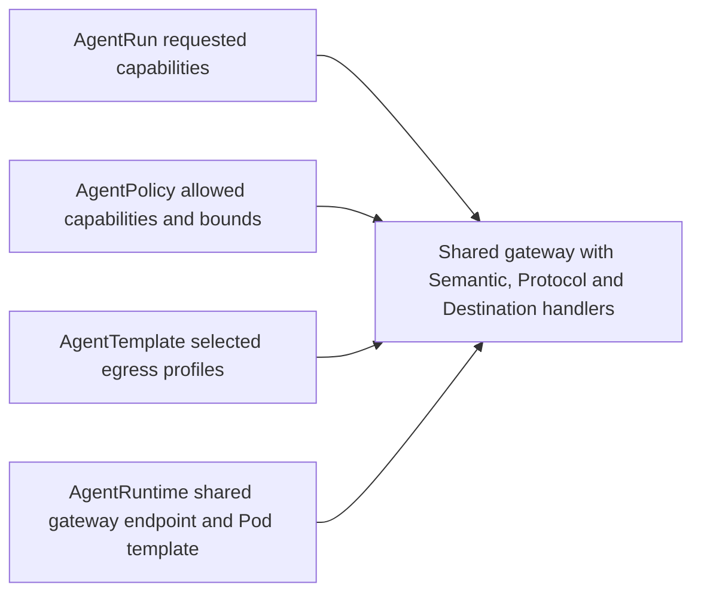

# Capabilities and gateways

A run requests [capabilities](../../GLOSSARY.md#capability). Policy decides
which requests are allowed and sets their limits. The
[gateway](../../GLOSSARY.md#gateway) checks each service operation against the
run and current policy. Provider credentials stay in the gateway.

Read [core concepts](core-concepts.md) for an introduction to runs, templates,
runtimes and policies. This page explains how their permission checks combine.

## Mental model

The gateway checks different information for different types of request. The
implementation calls these enforcement tiers:

| Tier | What the gateway checks | Example |
| --- | --- | --- |
| Semantic | Service resources and actions. | Read Pods in one namespace or create a PR from a run-owned branch. |
| Protocol | Allowed operations and request arguments. | Call selected MCP tools with restricted arguments. |
| Destination | Exact network host, port and protocol. | Send HTTPS requests to one approved host. |

These tiers describe what the gateway understands. They are not increasing
permission levels. Destination access cannot restrict service actions as
precisely as a handler that understands those actions.

CLI, HTTP proxy and MCP are ways to send requests. They do not determine the
enforcement tier. For example, the demo's `kubectl`, `git` and `gh` calls use
Semantic checks because the gateway checks their resources and actions.
Installing a tool does not grant service access.

The resources have separate responsibilities:

- `AgentRun` requests an explicit capability subset.
- `AgentPolicy` allows or denies that subset and sets limits.
- `AgentTemplate` supplies trusted instructions and selects egress profiles.
- `AgentRuntime` selects the gateway endpoint and Pod configuration.
- The gateway authenticates the run and checks the requested operation.

## How capability grants become usable

### `model.inference`

The run must request `model.inference`, and current policy must allow it. An
optional `AgentPolicy.spec.budgets[model.inference]` entry limits tokens and
cost. These limits are not hard spending ceilings; see
[security hardening](../reference/security-hardening.md#model-budgets-are-not-hard-spending-ceilings).

### `network.egress`

All of these conditions must hold:

1. The run requests `network.egress`.
2. The policy permits the named egress profile.
3. The template selects the same profile.
4. The gateway approves the exact destination host, port and protocol.

### `github.pull_request`

The run requests `github.pull_request`. The gateway checks the run, approved
repository scope and revision contract before publishing a PR. The sandbox
receives no GitHub provider credentials.

### `mcp.<server>`

A remote MCP server must have an approved HTTPS endpoint in the gateway
registry. The run must request its named capability, and current policy must
explicitly allow its tools. The gateway checks arguments against the discovered
input schema and any additional policy restrictions.

Each incoming request uses a private upstream session. Attempted tool calls
count against the Run UID and named capability budget. Provider credentials stay
in the gateway. Native Kubernetes MCP instead uses `kubernetes.read` and the
same Semantic handler as Kubernetes REST reads.

See [configured MCP](../reference/configured-mcp.md), [native Kubernetes
MCP](../reference/kubernetes-mcp.md) and [ADR
0001](../adr/0001-mcp-capabilities-through-shared-gateway.md). For the full
capability list, including package downloads, see [permissions and
capabilities](../reference/permissions-and-capabilities.md).

## Why this matters

Prompts can't grant permissions. Every request must get past the network
boundary, the run identity, the requested capabilities, current policy and the
upstream service's own restrictions. These checks must hold even if the task
text is hostile or the sandbox is compromised.

Deployment still requires enforced network isolation, inspected TLS, namespace
separation, GitHub protections and durable gateway state. See [security
hardening](../reference/security-hardening.md) for the controls and known
limits.

## Implementation map

Each service handler implements `http.Handler` beneath `internal/endpoints`. The
shared gateway routes requests to these handlers.

| Tier | Module | Supported behaviour |
| --- | --- | --- |
| Semantic | `internal/endpoints/kubernetes`, `internal/endpoints/github`, `internal/endpoints/model`, `internal/endpoints/packages` | Service-specific action checks. |
| Protocol | `internal/endpoints/mcp` | Registered remote tools, discovered input schemas and additional policy argument restrictions. |
| Destination | `internal/endpoints/destination` | Inspected HTTPS to exact profile hosts and ports. |

`internal/proxytransport` handles authentication, TLS inspection, session
revocation and removal of workload credential headers. It validates each
execution grant once, at that boundary. `Dispatcher` in
`internal/gateway/dispatch.go` selects the `Route` for an exact authority. The
route is the single source of the capability and enforcement tier. Before any
handler runs, the dispatcher denies and audits a request whose run or current
policy does not grant the route's capability. Dispatcher denials use one JSON
error body that Anthropic and OpenAI clients parse. Handlers start audit
events with `gateway.AuditEvent`, which copies the route's capability and tier, and then
check the operation itself. The MCP route has no fixed capability. Its handler
selects the named capability from the validated gateway path and checks it with
the same `ExecutionGrant.Permits`.

`internal/endpoints/authorities.go` lists the semantic service authorities.
Each endpoint package owns its own authority constant, and both the shared and
Docker gateways reserve every listed authority.

Destination routes come from configured egress profiles. The inspection
certificate must cover every workload destination host. Registered MCP provider
addresses are reserved against destination routing; the gateway validates their
upstream TLS separately. Semantic service addresses stay reserved even if their
handler is disabled. Generic egress cannot bypass a disabled service handler.

Raw CONNECT tunnels, plaintext HTTP and protocol upgrades are unsupported. The
shared dispatcher preserves streaming responses. Model handlers buffer responses
to verify usage.

## Endpoint interface and spending

The dispatcher supplies the authenticated run and its route in request context.
For fixed native capabilities it checks the capability grant and supplies an
optional `budget.Meter`. The MCP handler
resolves its named capability and meter from the path and current policy.

`internal/budget` defines shared accounting rules and memory and Kubernetes
storage adapters. `Meter.Spend` charges known usage before forwarding.
`Meter.Reserve` holds capacity for variable usage. The handler then settles
actual usage or releases the reservation.

Model handlers settle provider-reported usage at administrator prices.
[Security hardening](../reference/security-hardening.md#model-budgets-are-not-hard-spending-ceilings)
explains why that is not a hard ceiling. Other native handlers charge one unit
per authorized upstream request, including each GitHub read-back request.
Configured MCP charges one unit before each tool call, including calls that
fail. Its initialization and discovery have separate limits and cost no units.

## Future extensions

The [managed-server proposal](future-architecture/managed-mcp-servers.md) describes
server lifecycle support and stronger service-specific checks. CLI and HTTP
delivery remain available alongside MCP.
