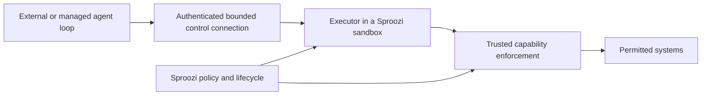

# Additional harness and client compatibility

Status: future extensions to the supported clients.

Sproozi supports ordinary launches for Codex, Claude Code, OpenCode and Hermes.
Managed session movement supports Codex and Claude Code. See the
[harness reference](../../reference/harnesses.md) for configuration and limits.
This page covers additional state formats and client connections.

A harness owns its agent loop, conversation semantics and user experience.
Sproozi owns the bounded environment and external authority available there.
Extend the current launch adapters only when a concrete resume or control requirement
needs it; a generic harness registry is not a prerequisite.

## Session adapters preserve native state

For further [moves between placements](session-mobility.md), a harness adapter needs to report
whether the installed version and session are movable, reach a supported safe
boundary, export selected native state, validate compatibility and invoke native
resume in the restored workspace. Unsupported state must be reported explicitly.

Check path assumptions, environment dependencies, active tools and subprocesses,
conversation compaction, harness conversation identifiers and state-format versions.
Do not promise that copying transcript files reproduces the same harness conversation.
The runtime adapter provisions and stops the environment; the harness adapter
handles harness conversation state. Neither can assume the other has stopped an
in-flight tool or established exclusive workspace ownership.

Preserve the selected native history's semantics. Codex can retain developer-role
records and remembered permissions; the adapter does not rewrite them as user
text. History remains untrusted for Sproozi authority and accounting. Generate
trusted launch settings and MCP connections again from destination policy.
Imported global settings, hooks, plugins and credential helpers cannot acquire
authority through checkpointing. Keep isolated sandbox homes and a strict state
allowlist for each separately proved native resume path.

The two implemented adapters deliberately use different completion evidence.
Codex has a checked final completed-turn event and retained instruction digest.
Claude has no reliable completed-turn marker or approved instructions in its
transcript. The trusted launch retains the instruction contract separately, while
the supervisor checks foreground lifecycle hooks and the selected settled leaf.
Those workload-accessible hints do not prove source revocation, actual container
stop or trusted usage. See
[ADR 0011](../../adr/0011-native-session-compatibility-and-completion.md).

## Client compatibility has separate levels

| Client connection | Purpose | Current support |
| --- | --- | --- |
| Native CLI resume | Resume through the client's own command. | Pinned Codex and Claude Code. |
| Remote terminal | Attach to the running CLI. | Managed Docker and Kubernetes sessions. |
| Native protocol | Connect an IDE or GUI to a remote session. | Future extension. |

Further native-protocol integration can investigate official session/server and
remote-control interfaces. These are separate experiment candidates, not claims
that the current desktop clients accept arbitrary Sproozi endpoints.
Vendor-managed cloud sessions are not proof of relocation between our own Docker
and Kubernetes environments. Recheck current official interfaces when
implementing; do not rely on undocumented session-file manipulation.

The accepted first client experience is native CLI locally and terminal attachment
remotely, under [ADR 0006](../../adr/0006-native-cli-and-terminal-before-gui-mobility.md).
GUI/IDE connection remains a future extension. [ADR 0007](../../adr/0007-codex-round-trip-before-harness-expansion.md)
selects the complete Codex round trip first, followed by Claude Code.

The first session starts through Sproozi in local Docker, under
[ADR 0005](../../adr/0005-controlled-docker-launch-before-session-adoption.md).
Later adoption of a directly
started harness conversation requires explicit user selection, safe state import and
control of the original writer. A copied session cannot import cached approvals
as a Sproozi grant. If native GUI access is unsupported, retain the proved CLI or
terminal path and describe that limitation.

## Remote execution and external loop control

A stock CLI running in a Pod is remote execution with the agent loop in the
sandbox. Reattaching a client to that process differs from placing the loop in an
external service that sends commands to a Sproozi executor.

An external loop could own session history, context compaction and interaction.
Sproozi must still own executor placement, identity, capability grants, deadlines,
cancellation and cleanup. Model-provider, executor-control and target-system
credentials are separate authorities. A generic egress grant alone does not
establish safe executor control.

The current gateway rejects HTTP protocol upgrades in
`internal/proxytransport/gateway.go`. A native control protocol that requires an
upgrade therefore needs a deliberate authenticated transport and lifecycle
design; existing model or MCP compatibility does not supply that control channel.

Before supporting an external loop, resolve how it binds to one bounded execution,
which events end a task, who stops an idle executor, and how disconnects, stale
commands and retries are reconciled. A persistent executor's process exit cannot
stand in for completion of every turn. Admission must also establish that the
harness's tools run in the selected environment rather than on an unrestricted
host or second executor.

## Testing requirements

See [harness and client requirements](../../../test/acceptance/README.md#harness-and-client-extensions)
for state, connection, completion and failure checks.
