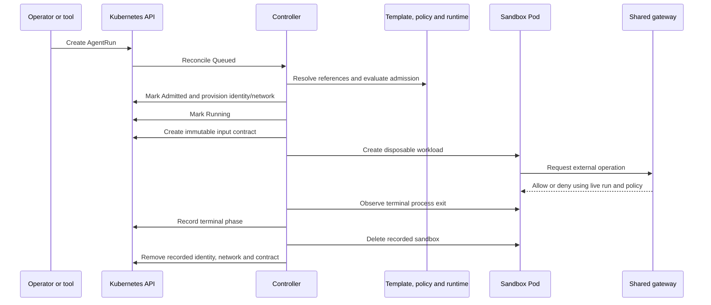

# Run lifecycle

An `AgentRun` requests one task through an administrator-owned template. It
records the requested capabilities, task text and event context. The controller
checks the request, starts the sandbox Pod, records its outcome and cleans up.

Read [core concepts](core-concepts.md) for the resource names. This page
describes the ordinary Kubernetes run lifecycle. Managed session stop and move
operations have [additional checks](../guides/session-mobility.md).



## Phases and admission

```text
Queued -> Admitted -> Running -> Succeeded | Failed | TimedOut | Cancelled
```

Before admission, the controller resolves the template, policy and runtime
references. It checks the requested capabilities and resource limits. If an
optional concurrency cap is full, for the cluster or for the run's policy, the
run stays `Queued` with reason `WaitingForConcurrencyCap` until an active run
finishes. There is no cluster cap by default, and no policy cap unless the
policy sets one, so runs are admitted concurrently. See
[AgentRun admission](../reference/agentrun.md#admission-and-concurrency-caps).

After admission, the controller creates a dedicated ServiceAccount,
NetworkPolicy and immutable input ConfigMap. It creates the Pod from the runtime
configuration. The workload ServiceAccount has no direct Kubernetes read
permissions. The gateway checks Kubernetes reads; the controller creates no
target-namespace Roles or RoleBindings for the run.

## Completion

The Pod adapter waits for the whole Pod to become terminal, then reads the exit
code of the container named `agent`. Zero means `Succeeded`; non-zero or
unavailable exit means `Failed`. Use one workload container with that name.
Long-running ordinary sidecars prevent completion. Review the task result
separately. A PR or agent summary does not determine run success.

Explicit cancellation and deadline expiry record `Cancelled` or `TimedOut` and
start Pod cleanup. They do not depend on the agent reporting an outcome.

## Cleanup and retention

Normal terminal handling and explicit deletion remove the recorded Pod before
releasing its contract ConfigMap, NetworkPolicy and ServiceAccount. The
`AgentRun` record remains until the policy's `retentionTTL` expires, unless you
delete it first.

If provisioning stopped before status was saved, cleanup looks up the Pod and
checks that it belongs to the run. It keeps identity and network controls until
the Pod is confirmed absent or terminal. Lookup errors, unknown Pod state and
ownership mismatches block cleanup. Managed sessions also need confirmation
that the writer stopped and its usage was finalized.

The gateway deletes a [BudgetLedger](../reference/budgetledger.md) once its AgentRun is gone, nothing is
reserved on it and it has not been written for `BUDGET_LEDGER_RETENTION`. See [security hardening](../reference/security-hardening.md#cleanup-and-state-retention)
for ownership checks and retained state.

## Gateway revocation

The projected gateway token lasts two hours; policy limits execution to one
hour. The demo reads the token once. The gateway does not wait for token expiry
to revoke access. It checks run identity and policy on every new connection and
request, and rechecks open connections every second by default. On Kubernetes,
the checks after the first read a watch cache, confirm any change live and run
a live recheck at least every 10 seconds per execution. Each policy lookup has a
five-second deadline, so a revocation closes open connections within 1 second
plus watch delay plus 5 seconds, or under 16 seconds if the watch stalls. Closing a connection doesn't prove that the upstream work
stopped. A model call cut off this way after the provider received its whole
request is charged an [estimated charge](../../GLOSSARY.md#estimated-charge),
capped at its reservation, even if its response hadn't started; one cut off
before the provider received the whole request is not charged. See the [transport
limits](../reference/security-hardening.md#protect-transport-and-identities).
The workload has no Sproozi proxy sidecar or local proxy process.
