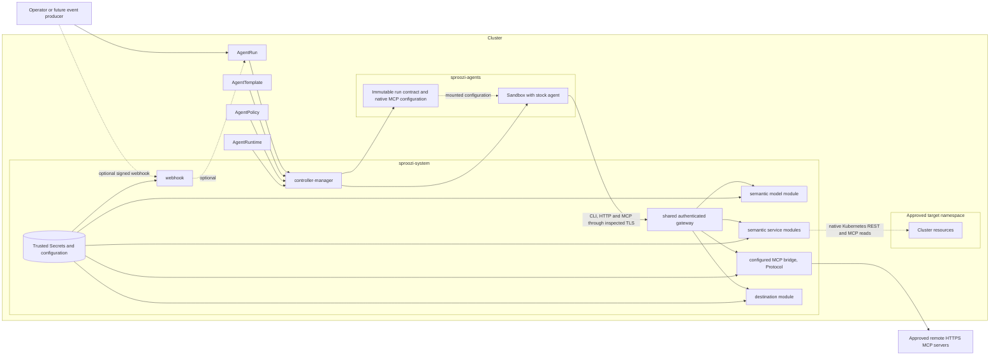
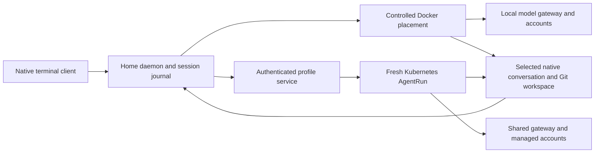

# System architecture

Sproozi separates agent execution from permission checks and provider
credentials. The agent runs in a sandbox. A trusted gateway checks its service
requests. A controller creates and cleans up Kubernetes runs.

Read [core concepts](core-concepts.md) first if the resource and session names
are new to you. This page explains where the components run and what they own.

## Kubernetes components

## Trust and namespace boundaries

The system uses separate namespaces:

- `sproozi-system` holds the trusted controller, webhook, gateway and provider credentials.
- `sproozi-webhooks` holds only webhook HMAC Secrets, the one place the webhook can read Secrets ([ADR 0022](../adr/0022-webhook-hmac-secrets-in-own-namespace.md)).
- `sproozi-webhook-state` holds the webhook's replay records.
- `sproozi-agents` holds untrusted agent Pods and their run identities, network policies and input contracts.
- Approved target namespaces, such as `sproozi-demo`, hold resources that an agent can inspect.

Task text, event payloads and provider output are untrusted. They cannot grant
permissions. The administrator controls runtimes, templates, policies and
gateway configuration.

## External-call invariant

With an enforcing CNI and the generated NetworkPolicy, external calls go through
the gateway. This includes Kubernetes API and MCP calls. The policy allows only
DNS and gateway egress. Operators must check that direct API and provider calls
fail in their environment. NetworkPolicy has exceptions for node traffic.

Each run has a dedicated ServiceAccount and a token for the gateway audience.
The token identifies the run. Its requested capabilities and current policy
determine permission. Each new request checks that the run is still active,
and open connections close soon after it stops. The agent Pod has no Sproozi
proxy sidecar.

Both gateway backends cap connections, sessions per execution and pending
policy lookups, and give authentication and lookups short deadlines. A late
lookup result can't restore permission. A slow policy lookup keeps its slot
until it returns, even after timing out.
[Transport limits](../reference/security-hardening.md#protect-transport-and-identities)
give the defaults and explain why closing a connection doesn't prove that
upstream work stopped.

The gateway routes each request to a handler. A handler can check service
actions, MCP tools and arguments, or an exact network destination. These checks
have different limits. See [capabilities and
gateways](capabilities-and-gateways.md).

## MCP is a supported capability interface

MCP clients use the same gateway and run identity as CLI and HTTP clients.

| Path | Required capability | What the gateway checks |
| --- | --- | --- |
| Native Kubernetes Pod-list tool at `https://kubernetes.default.svc/mcp` | `kubernetes.read` | The same namespace and resource rules as Kubernetes REST reads. |
| Registered remote tools at `/mcp/<server>` | `mcp.<server>` | Registered endpoint, allowed tools, discovered input schemas and optional policy argument restrictions. |
| Sproozi control connection at `/mcp/sproozi` | None | The authenticated execution; `diagnose` returns only that execution's recent gateway refusals. |

A compatible remote HTTPS MCP server needs registration and policy
configuration. It does not need a provider-specific Go adapter. The gateway
loads provider URLs and credential-file references at startup. Restart it to
apply registration or credential changes. Policy changes apply to later requests
without a restart.

Each incoming remote MCP request gets a private upstream session. The bridge
initializes it, discovers approved tools, makes at most one tool call and closes
it. Attempted calls count against the run's named capability budget.
Reconnecting does not reset usage. Tool discovery supplies interface
information, not permission.

The controller generates native MCP settings for Codex, Claude Code, OpenCode or
Hermes. The administrator's launch command loads these settings into fresh
client state. The settings contain gateway addresses, not provider credentials.

See [configured MCP](../reference/configured-mcp.md), [native Kubernetes
MCP](../reference/kubernetes-mcp.md) and [harnesses](../reference/harnesses.md)
for configuration and support limits. Managed stdio servers, OAuth consent and
upstream conversation continuity remain future work. [ADR
0001](../adr/0001-mcp-capabilities-through-shared-gateway.md) records the MCP
design decision.

## Persistent assistant delegation

Hermes runs separately from agent Pods. It keeps its native sessions, memory
and schedules on a persistent volume. Its MCP client submits tasks to a private
service that maps workflow names to fixed templates and capability subsets.
Hermes receives no Kubernetes token.

The task service holds the Kubernetes credentials needed to create approved
`AgentRun` requests. The controller runs them through the ordinary worker queue
and gateway. It saves terminal status and optional final text before deleting
the Pod. The persistent assistant does not occupy the single worker slot.

See [the task interface](../reference/orchestration.md), [the Hermes
guide](../guides/hermes-orchestration.md) and [ADR
0003](../adr/0003-persistent-assistants-and-retained-results.md).

## Kubernetes execution

The Kubernetes adapter creates disposable Pods directly; see
[cluster dependencies](../reference/dependencies.md). Each run receives an immutable input
contract, a projected gateway token and a run-specific NetworkPolicy. Its
ServiceAccount has no direct Kubernetes read grant.

## Managed native session continuity

The [home daemon](../../GLOSSARY.md#home-daemon) manages controlled Docker
sessions. It connects to a [profile service](../../GLOSSARY.md#profile-service)
to place work on Kubernetes. The profile holds Kubernetes
credentials; the home daemon does not need them. Each remote visit creates a
fresh `AgentRun` and must pass current policy checks.

During a live move, the [execution](../../GLOSSARY.md#execution) keeps its
native conversation ID, original deadline and total
[allowance](../../GLOSSARY.md#allowance). Each [visit](../../GLOSSARY.md#visit)
gets a fresh allocation and placement identity. A checkpoint carries the supported conversation and Git
workspace. It carries no credentials or permission to spend.

To move safely, Sproozi blocks new input, waits for the current turn and tools,
revokes access and confirms that every source [writer](../../GLOSSARY.md#writer)
has stopped. It then records [finalized usage](../../GLOSSARY.md#finalized-usage)
and captures the checkpoint. Only then can the destination start. If Sproozi
can't confirm the stop or the usage, the reserved allowance stays held and the
destination doesn't start. Forced cancellation revokes access
first and does not require a fresh checkpoint.

The home coordinator records each execution from its first visit. `start` and
`resume` save that visit before any container starts. The coordinator then
prepares, activates, stops, moves, cancels and recovers every visit the same
way. A visit started from a Git workspace has no native conversation ID until
the client creates one. Its first graceful stop records that ID separately,
because a visit's launch settings never change. See [ADR
0018](../adr/0018-coordinator-owns-every-visit.md).

[Remote work and local resume](../guides/portable-workflows.md) uses a catalogue hosted by
the profile service. It runs independently of the laptop. After a Codex task
finishes, it stops the worker, finalizes usage and retains native and Git state.
Hermes can submit and inspect tasks through authenticated MCP.

Pull transfers ownership to the home daemon without starting an agent. A
later resume starts a new execution with current local approval and the same
native conversation ID. Old usage receipts remain unchanged. Retried operations
stay bound to their original execution, so they cannot affect a later resume.
See [ADR 0012](../adr/0012-retained-work-and-fresh-session-continuations.md).

Projects group retained work and restrict access under administrator
configuration. A saved Project association records where work came from; local
resume still requires local approval. An exact-revision launch starts a fresh
conversation at the checkpoint's Git commit. It does not restore unfinished
changes or the old conversation. See [Projects and workspace
revisions](../reference/projects-and-revisions.md) and [ADR
0013](../adr/0013-configured-projects-and-workspace-revisions.md).

Docker and Kubernetes share the same trusted launch settings, and both check
that every control reply names the expected operation, state and conversation
ID. Each backend still confirms its own container stop and usage. See [native
control](../reference/native-control.md) and [ADR
0014](../adr/0014-review-boundaries-and-native-contracts.md). ACP and AHP are
possible future integrations; neither is exposed as a Sproozi endpoint.

The public `id` names the [session](../../GLOSSARY.md#session).
`executionId`, `allocationId` and `incarnation` name the current execution,
visit and writer. See [session commands](../reference/session-commands.md) for
choosing an owner and reading the catalogue.

## Implementation locations

Runtime implementations are in `internal/runtime/kubernetes` and
`internal/runtime/docker`. Shared harness, checkpoint and workspace code is
independent of those backends. Shared accounting rules are in `internal/budget`;
Kubernetes persistence is in `internal/budget/kubernetes`.

Policy, gateway authentication, model credentials and task services also keep
Kubernetes-specific code in `kubernetes` subpackages. Controller and API
scaffold paths remain unchanged. [ADR
0009](../adr/0009-runtime-backends-and-sealed-accounting.md) records these
boundaries.

## Future architecture

The [future architecture overview](future-architecture/README.md) covers managed
MCP servers, more harnesses, GUI and IDE clients, adoption of existing sessions,
and broader profile services. Each extension needs its own implementation and
tests.
