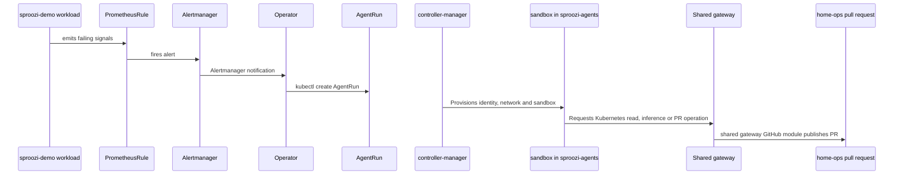

# Home-ops playbook

This guide describes a planned Sproozi installation in
[`andrewmccall/home-ops`](https://github.com/andrewmccall/home-ops). It uses
that repository's Flux layout. For a working first installation, start with
[Install on Kubernetes](install-kubernetes.md).

This is a planned integration. The recorded manual Kind runs did not exercise
a home-ops PR or Flux recovery. Sproozi has no event receiver, so an
Alertmanager alert cannot start a run; you create the AgentRun by hand. See
[event webhooks](../explanations/future-architecture/event-webhooks.md).

## Outcome

You will add:

1. a Sproozi app bundle under `cluster/apps/sproozi/`
2. SOPS-managed Secrets and supporting config for the shared gateway modules
3. the SRE demo stack and broken demo workload
4. Alertmanager rule and routing changes under `cluster/apps/monitoring/alerts/`

## Expected home-ops layout

Use these paths in the home-ops repository:

| Path | Purpose |
| --- | --- |
| `cluster/apps/sproozi/` | Sproozi app bundle, namespaces, CRs, ConfigMaps, and SOPS-managed Secrets |
| `cluster/apps/monitoring/alerts/prometheus-rules.yaml` | demo alert rule |
| `cluster/apps/monitoring/alerts/alertmanager-config.yaml` | Route the demo alert to your usual notification receiver. |

## 1. Publish a pinned Sproozi release artifact

From this repository:

```sh
export IMG=<registry>/sproozi:<tag>
make docker-build docker-push IMG=$IMG
make build-installer IMG=$IMG
```

Commit or reference the resulting `dist/install.yaml` from `home-ops` at a pinned tag or revision.

## 2. Add a new Sproozi app bundle

Create `cluster/apps/sproozi/` and add the files that own:

- `sproozi-system`, `sproozi-agents`, and `sproozi-demo` namespaces
- the pinned Sproozi install bundle
- `AgentRuntime`, `AgentPolicy`, and `AgentTemplate`
- the demo workload
- trusted-service configuration

A practical starter set is:

- `cluster/apps/sproozi/kustomization.yaml`
- `cluster/apps/sproozi/namespaces.yaml`
- `cluster/apps/sproozi/sproozi-install.yaml`
- `cluster/apps/sproozi/agentruntime.yaml`
- `cluster/apps/sproozi/agentpolicy.yaml`
- `cluster/apps/sproozi/agenttemplate.yaml`
- `cluster/apps/sproozi/demo-workload.yaml`
- `cluster/apps/sproozi/egress-gateway-profiles.yaml`
- `cluster/apps/sproozi/model-gateway-credentials.sops.yaml`
- `cluster/apps/sproozi/capability-proxy-github-app.sops.yaml`

## 3. Add SOPS-managed secrets and config

`home-ops` should own the real trusted-service inputs:

- `Secret/model-gateway-credentials` in `sproozi-system`
- `Secret/capability-proxy-github-app` in `sproozi-system`
- `ConfigMap/sproozi-egress-gateway-profiles` in `sproozi-system`
- `Secret/sproozi-gateway-tls` with managed inspection TLS in `sproozi-system`
- immutable `ConfigMap/sproozi-sandbox-trust` in `sproozi-agents`, referenced by the runtime's client trust configuration
- the model pricing and authentication configuration described in [required secrets and config](../reference/required-secrets-and-config.md)

Keep static credentials in SOPS-managed manifests in `cluster/apps/sproozi/`.
For ChatGPT authentication, the gateway owns the Secret holding the rotating ChatGPT credential;
do not reconcile it from a stale bootstrap file. See
[Model provider authentication](model-provider-auth.md).

## 4. Add the SRE demo stack

The first `home-ops` template should:

- reference exactly one runtime and one policy
- target `andrewmccall/home-ops` for `github.pull_request`
- target `sproozi-demo` for `kubernetes.read`

## 5. Add the broken demo workload

Place the workload under `cluster/apps/sproozi/` in `sproozi-demo`. The
manual demo uses `exit 1`, which produces `CrashLoopBackOff`. An invalid image
tag instead produces `ImagePullBackOff`.

Adapt trusted template instructions to the home-ops path
`cluster/apps/sproozi/demo-workload.yaml` and bounded `gh api` REST PR creation.
The local example and acceptance suite expect repository-root `demo-workload.yaml`;
do not run that suite against home-ops unchanged.

## 6. Wire alerting under monitoring

Keep monitoring-owned changes in `cluster/apps/monitoring/alerts/`:

- add a `PrometheusRule` that selects the demo workload
- route an `AlertmanagerConfig` notification to your usual receiver

Sproozi has no event receiver, so the alert cannot start a run. When the alert
fires, write an [AgentRun](../reference/agentrun.md) that names the template
and copies the alert details into `spec.eventContext`. Give it
`metadata.generateName` rather than a fixed name, so each alert gets its own
run. Then create it:

```sh
kubectl create -f agentrun.yaml
```

See [event webhooks](../explanations/future-architecture/event-webhooks.md) for
what an automatic trigger would need.

## 7. Reconcile and observe the workflow



After Flux reconciliation, watch:

```sh
kubectl get deploy -n sproozi-system
kubectl get agenttemplates.sproozi.com -n sproozi-system
kubectl get agentruns.sproozi.com -A
kubectl get pods -n sproozi-agents
```

## Scope of this playbook

The integration is planned. After the agent proposes a PR, review and merge it
before Flux applies the change. The [core
concepts](../explanations/core-concepts.md) apply outside this repository
layout.
